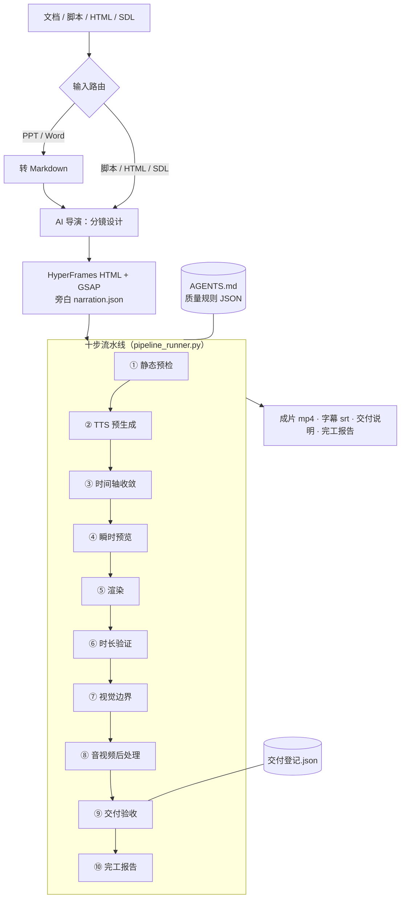
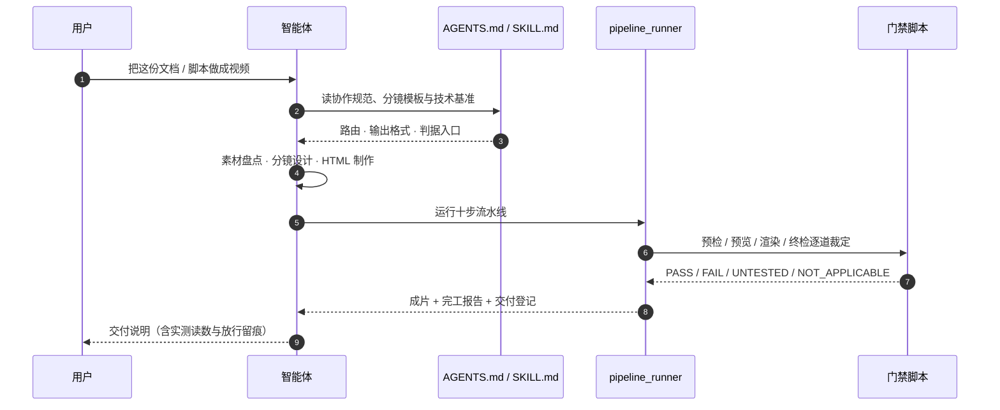
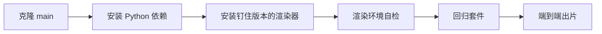

<div align="center">
  <h1>AI 视频制作工作流</h1>
  <p>文档 / 旁白脚本 / HTML → 成片的一体化生产流水线</p>
  <p>
    
    
    
    
  </p>
</div>

> **一句话定位**：把「文档 / 脚本 → 分镜 → HTML+GSAP → TTS → 渲染 → 字幕 → 交付」做成一条可被任何 AI 编码智能体或纯命令行驱动的流水线。所有「成功」都必须有实测证据：**检查没跑成，不得写成通过**。

> **先看边界**：安装对象只有默认分支 `main`。Releases 页的 `v1.0.0` 是历史快照，其依赖表仍写「安装最新」——照做会装上有已知缺陷的渲染器版本，**不要按它安装**。本仓不绑定任何智能体平台；业务成片、字幕与客户素材不入库。

## 目录

- [这是什么](#这是什么)
- [能力地图](#能力地图)
- [一次任务怎么走](#一次任务怎么走)
- [流水线十步](#流水线十步)
- [门禁与证据体系](#门禁与证据体系)
- [公开面边界（随包 / 不随包）](#公开面边界随包--不随包)
- [快速开始](#快速开始)
- [环境依赖](#环境依赖)
- [目录结构](#目录结构)
- [智能体驱动说明](#智能体驱动说明)
- [新建自己的项目](#新建自己的项目)
- [版本与迭代策略](#版本与迭代策略)
- [引用与署名](#引用与署名)
- [边界与免责声明](#边界与免责声明)

## 这是什么

一条面向**真实交付**的视频生产流水线，不是一组提示词模板。它把制作过程中最容易失真的三件事——旁白、时间轴、质量结论——各自收敛到单一权威源，再用可复算的门禁逐道裁定。

| 你给什么 | 流水线做什么 | 你会拿到 |
|---|---|---|
| 一份 PPT / Word 产品资料 | 转 Markdown → AI 导演分镜 → 生成 HTML 场景 → 十步流水线 | 分镜设计稿、HTML 项目、成片、字幕、交付说明、完工报告 |
| 一份 Markdown 旁白脚本 | 素材盘点 → 分镜设计 → HTML 制作 → 十步流水线 | 同上 |
| 一个已有的 HTML+GSAP 项目 | 直通十步流水线，按输入指纹裁定哪些步骤需要重跑 | 成片与完整实测证据 |
| 一个 SDL YAML | 走 `--sdl` 一键入口 | 同上 |
| 一支旧片要改几处文案 | 场景级增量渲染：只重渲变化的场景，其余帧从基线复用 | 新成片，渲染时间按变化面而不是片长计 |

三层分工：

| 层 | 载体 | 负责 |
|---|---|---|
| 编排层 | `AGENTS.md` ＋ `.qoder/skills/creating-video-projects/SKILL.md` | 输入识别、工具链路由、分镜与 HTML 制作规范 |
| 执行层 | `程序文件/脚本/pipeline_runner.py` | 十步流水线、断点续跑、缓存与增量渲染 |
| 裁定层 | `程序文件/脚本/` 下的门禁脚本 ＋ `程序文件/配置/config/quality/*.json` | 每一道检查的四态裁定与留痕 |

## 能力地图



## 一次任务怎么走



智能体负责创作与编排，流水线负责执行与取证。**评审结论不来自模型自评**：完工报告的 `--audit` 由治具按六维裁定，任一失败即非零退出。

## 流水线十步

| # | 步骤 | 做什么 | 失败时 |
|---|---|---|---|
| ① | 静态预检 | 设计产物、HTML 场景结构、时间轴注册、章级条、画面标点、cue 声明 | 阻断，零渲染 |
| ② | TTS 预生成 | 分场景合成、产物七层验证、句界停顿与缓存复用 | 阻断 |
| ③ | 时间轴收敛 | 按 TTS 实测时长收敛场景窗口、时长预算检查 | soft 需显式放行，hard 直接失败 |
| ④ | 瞬时预览 | 秒级截图，检查字幕安全区、文字塌陷、柱状图纵向溢出 | 阻断，避免用全量渲染试错 |
| ⑤ | 渲染 | HyperFrames 全量渲染或场景级增量渲染；卡死看门狗与渲染成本预算 | 阻断或自动降级全量 |
| ⑥ | 时长验证 | 成片实测时长与声明时长一致性 | 留痕，偏差超限即失败 |
| ⑦ | 视觉边界 | 字幕安全区与画面边界判定（画面占用只作报告读数，不设门禁） | 阻断 |
| ⑧ | 音视频后处理 | 混音、ASR 强制对齐、字幕烧录与样式分档、成片终检 | 阻断 |
| ⑨ | 交付验收 | 交付槽位写入、交付登记、清理审计 | 阻断 |
| ⑩ | 完工报告 | 数据驱动报告 ＋ 六维审计 | 非 VALIDATED 即不视为交付 |

任一步失败都会把日志路径与错误码写进 `pipeline_state.json`；输入变化后由指纹自动判定需要重跑的最小步骤集，无需手工推断。

## 门禁与证据体系

| 机制 | 它保证什么 |
|---|---|
| **单一权威源** | 旁白只在 `narration.json`；时间轴只在 HTML 的 T 块；交付路径只在项目 config。配置不再内嵌场景表。 |
| **输入指纹** | 每个步骤登记**真实读取**的输入 SHA256；任一输入变化即失效重跑，显式 `--step` 起跑也要过同一判据。 |
| **四态裁定** | 所有检查点统一返回 PASS / FAIL / UNTESTED / NOT_APPLICABLE。有 FAIL 即失败；无 FAIL 但有 UNTESTED，整体不得写成通过。 |
| **预览期判据** | 字幕溢出、文字塌成竖排、柱状图纵向溢出都在秒级预览内阻断，不靠全量渲染发现。 |
| **渲染期守卫** | 渲染卡死看门狗、全量渲染次数预算、场景级增量渲染、成片空画面检测。 |
| **终检与对齐** | TTS 七层验证、媒体四态质量检查、ASR 强制对齐与字幕时间戳来源统计。 |
| **交付守卫** | 交付槽位只由成功链末端写入；已交付成片不得被任何模式覆盖；交付登记由流水线自动写入。 |
| **完工审计** | 数据驱动报告，禁止硬编码 PASS；`--audit` 按真实性、门禁完整性、合规、分镜忠实度、收尾、交付说明一致性六维裁定。 |

回归套件覆盖上述判据的关键链路，每条新判据须配用例与变异矩阵。**用例数量与通过数以运行时 `[SUMMARY]` 为准**，本文不抄写数字：

```bash
python 程序文件/脚本/regression_test.py --run-all
```

## 公开面边界（随包 / 不随包）

本仓是**工具与夹具的分发面**，不是交付物仓库。

| 类别 | 随包 | 不随包 |
|---|---|---|
| 流水线与门禁 | `程序文件/脚本/**`、`程序文件/配置/**` | — |
| 模板与规范 | `AI视频制作工作流模板/**`、`AGENTS.md` | — |
| Skill 定义 | `.qoder/skills/creating-video-projects/` | — |
| 示例夹具 | `程序文件/源码/hyperframes/quickstart-demo/`、`bgm-showcase-test/`，以及夹具样例 `成果文件/交付说明_quickstart-demo.md` | — |
| 业务交付物 | — | 成片、字幕、交付说明、交付登记（`成果文件/**` 除夹具样例与 `.gitkeep` 外默认拒绝） |
| 客户素材 | — | `素材文件/**` |
| 过程产物 | — | `过程产物/**`：日志、缓存、渲染中间件、预览截图 |

**为什么这样切**：成片、字幕与素材是使用者的业务资产，不是工具的一部分。它们在**你的克隆**里生成，由 `.gitignore` 默认拒绝提交；因此 `git pull --ff-only` 不会与你的交付物冲突。

## 快速开始



```bash
# 1. 克隆默认分支（安装对象只有 main）
git clone https://github.com/eiway112/video-production-skill.git
# 国内网络可用同一内容的镜像：
# git clone https://gitee.com/eiway112/video-production-skill.git

# 2. 安装 Python 依赖
pip install -r 程序文件/requirements.txt

# 3. 安装渲染器（版本钉住，勿用 latest）
npm install -g hyperframes@0.7.52

# 4. 环境自检：先确认"渲染实际会用哪一份、什么版本"
npx --no-install hyperframes --version
#    → 0.7.52＝对；0.8.x＝有一份本地副本抢先解析（宿主自带的 node workspace 常见），
#      正确动作是把那份本地件改名/移走（可逆），不是再装一次全局；not found＝尚未安装。
#    若上一条给出 0.8.x，用这条定位那份遮蔽副本住在哪个目录（须在被怀疑的那个目录里跑；
#    在本仓目录跑必然 MODULE_NOT_FOUND——Node 的解析路径不含 npm 全局根，此命令只用于定位本地件）：
node -e "const{createRequire}=require('module');console.log(createRequire(process.cwd()+'/x.js').resolve('hyperframes/package.json'))"

# 5. 自证那份副本能否真正加载（版本号可读 ≠ 渲染入口可加载）
python 程序文件/脚本/render_env_sentinel.py --check-render-env

# 6. 跑回归测试验证环境
python 程序文件/脚本/regression_test.py --run-all

# 7. 端到端渲染示例项目
python 程序文件/脚本/pipeline_runner.py --config quickstart-demo.json --fresh
```

成片输出至 `成果文件/视频/quickstart-demo.mp4`，字幕输出至 `成果文件/字幕/quickstart-demo.srt`，完工报告同步生成。交付说明按 `AI视频制作工作流模板/templates_07_交付说明模板.md` 撰写；已建说明时，流水线会把字幕时间戳来源节同步进去。

## 环境依赖

| 依赖 | 版本 | 安装方式 | 说明 |
|---|---|---|---|
| Python | ≥ 3.10 | 官方安装包 | `pip install -r 程序文件/requirements.txt` |
| FFmpeg（含 ffprobe） | ≥ 4.4 | 需在 PATH | silencedetect 过滤器必需 |
| Node.js | ≥ 18 LTS | 官方安装包 | 渲染器由 npx 调用 |
| hyperframes 渲染器 | **0.7.52（钉住）** | `npm install -g hyperframes@0.7.52` | 全局 npm 包；流水线经 `npx hyperframes render` 调用。**不要装 0.8.x**，原因见下节。 |
| Chrome | 稳定版 | 官方安装包 | 预览与渲染载体 |
| DashScope API Key | — | 用户自备（可选） | qwen（CosyVoice）TTS 主引擎，正式交付必需；无 Key 时可显式声明 Edge-TTS 做零成本自检 |
| GSAP | 3.14.2 | 随仓携带，无需安装 | 位于 `程序文件/源码/hyperframes/quickstart-demo/gsap.min.js`，许可见文件头（GreenSock Standard License） |
| 环境变量 `VIDEO_WORKFLOW_ROOT` | — | 可选 | 非同构目录部署时显式指定仓根；根探测失败会直接报错，不静默降级 |

### 为什么渲染器钉在 0.7.52

0.8.x 起，`render` 入口会无条件执行浏览器 `--version` 探测：超时上限写死在渲染器内部，没有开关，也没有环境变量可以绕过（显式给出 `HYPERFRAMES_BROWSER_PATH` 也绕不过）。在 Chrome 进程创建病态的机器上，按「最新」安装等于必然出不了片，报错是 `Chrome cannot start`。

升级前先跑升级面哨兵，裁定本机能否安全升级；渲染前再跑渲染面哨兵，裁定解析到的那份副本现在能不能用：

```bash
python 程序文件/脚本/render_env_sentinel.py --target <拟升版本>       # 这台机器能否安全升级
python 程序文件/脚本/render_env_sentinel.py --check-render-env       # 现在这份副本能否渲染
```

**版本号可读 ≠ 渲染入口可加载**：一份 `package.json` 印着版本号、`--version` 照回显的副本，仍可能在入口 import 期即崩（缺包体，或平台原生二进制与本机不符）。所以第 5 步不是可选项；流水线在渲染步起跑前也会自动跑同一条检查，FAIL 即拦下。

版本权威值是 `程序文件/配置/config/quality/render_rules.json` → `upgrade_sentinel.pinned_version`，上表是它的同形复述，由回归用例对撞。

### API Key 配置（可选）

如需使用 qwen（CosyVoice）TTS，将真实 Key 写入 `程序文件/配置/openmontage.env.local`（已被 `.gitignore` 保护，**切勿**写入 `openmontage.env` 提交入库）：

```
DASHSCOPE_API_KEY=<阿里云百炼控制台获取的 API Key>
```

不配置 Key 时，可在项目 config 显式声明 `"tts_engine": "edge"`，用免费的 Edge-TTS 跑通全流程自检。流水线禁止跨引擎自动降级（音色会不一致），正式交付仍以 qwen（CosyVoice）主引擎为准。

## 目录结构

```
<仓根>/
├── AGENTS.md                        # 智能体协作规范（根目录探测标记①，勿改名）
├── .qoder/skills/creating-video-projects/SKILL.md
│                                    # 智能体 Skill 定义（流程文档，可移植至任意运行时）
├── AI视频制作工作流模板/            # 分镜、HTML 技术基准、交付说明与踩坑清单
├── 程序文件/                        # 根目录探测标记②
│   ├── requirements.txt
│   ├── 脚本/                        # 流水线与门禁脚本
│   ├── 配置/                        # 项目 config、质量阈值与校验规则
│   └── 源码/hyperframes/            # 示例夹具（quickstart-demo / bgm-showcase-test）
├── 素材文件/图片/                   # 用户素材（不入库）
├── 过程产物/临时产物/               # 中间产物（不入库）
└── 成果文件/视频/ + 成果文件/字幕/  # 交付产物（不入库）
```

## 智能体驱动说明

本仓的端到端流程不绑定任何特定智能体平台：

- **通用路径（任意 AI 编码智能体）**：在 Qoder、Claude Code、Cursor、Codex CLI 等任一能读写文件的智能体中打开本仓，让它先读 `AGENTS.md`（协作规范）与 `.qoder/skills/creating-video-projects/SKILL.md`（流程定义，路径为 Qoder 约定位置，内容本身平台无关），然后提出「帮我把这份文档做成视频」即可触发 分镜设计 → HTML 制作 → TTS → 渲染 → 质量门禁 的标准链路。
- **手工路径（无智能体）**：按「新建自己的项目」逐步执行 `pipeline_runner.py`，同样可完整出片。

关键参照文档：

- 技术基准：`AI视频制作工作流模板/HyperFrames_HTML模板参考基准.md`
- 分镜设计：`AI视频制作工作流模板/分镜设计模板_AI导演模式.md`
- 避坑清单：`AI视频制作工作流模板/新路径实施_踩坑清单与防范检查表.md`
- 交付说明：`AI视频制作工作流模板/templates_07_交付说明模板.md`
- 协作规范：`AGENTS.md`（Tier 1-3 强制约束）

## 新建自己的项目

1. 复制 `程序文件/源码/hyperframes/quickstart-demo/` 为新项目目录，改写 `narration.json`（权威旁白源）与 `index.html`（GSAP 场景）。
2. 复制 `程序文件/配置/config/quickstart-demo.json` 为 `<项目名>.json`，同步改 `paths` 并保留 `narration_source` 指针。
3. 如需背景音或项目级质量参数，在 config 中显式声明；背景音默认关闭，声明 `bgm_source` 时必须同时声明开关。
4. 运行：

```bash
python 程序文件/脚本/pipeline_runner.py --config <项目名>.json --fresh
```

首次跑完建议先看完工报告的实测读数，再决定是否需要调整分镜或时间轴；不要凭观感直接重跑全量渲染。

## 版本与迭代策略

- **安装对象唯一＝默认分支 `main`**。本仓按导出批次滚动更新，`git clone` 与 `Code → Download ZIP` 取到的都是它；落地即生效，不需要等版本标签。
- **Releases 不承载安装**。`v1.0.0` 是 2026-07 的历史快照，按「不改写历史」的裁定保留；其依赖表写的是「安装最新」，与当前钉住版本不一致，**不要照它安装**。安装请回到本文件与默认分支 `main`。
- **版本自证**：流水线每次起跑会打印一行 `[VERSION]`，回答「这份技能是哪一版、是否落后」，并在需要时点名动作。该行只提示、不阻断——离线使用是合法场景。
- **更新方式**：

```bash
git pull --ff-only
```

- **向后兼容**：新增门禁默认 fail-closed，但只对新输入生效；历史项目的既有交付物与交付登记不受影响。升级后首次运行可能出现步骤重跑，这是指纹按真实输入重算的结果，不是缺陷。
- **反馈与纠错**：欢迎开 Issue（使用问题、判据误报、文档失效线索均可）。涉及判据的变更须附用例与变异矩阵，随导出批次进入公开面。

### 一次性迁移：`成果文件/交付登记.json` 不再入库跟踪

它是流水线每次交付**在你本地自写**的运行台账（已交付成片的实测时长、字节与配置），各仓内容本就不同，所以自本批起随 `成果文件/**` 默认拒绝块一并忽略，工作树保留自用。

若你的克隆里它仍是已跟踪文件、且本地被交付改写过，第一次 `git pull --ff-only` 会报 `Your local changes to the following files would be overwritten by merge`。让路即可，内容不丢：

```bash
mv 成果文件/交付登记.json 成果文件/交付登记.json.bak
git pull --ff-only
mv 成果文件/交付登记.json.bak 成果文件/交付登记.json
```

迁移后该文件未跟踪且被忽略，此后「本地刚交付一次 ＋ 上游又推新批」这种形态下复拉照常通过，台账内容逐字保留。

## 引用与署名

本仓库采用 [MIT License](LICENSE)。复制、引用或二次开发请保留版权声明。建议引用格式：

> AI 视频制作工作流，Copyright (c) 2026 AI Video Workflow Contributors，https://github.com/eiway112/video-production-skill

## 边界与免责声明

- 流水线保证的是**过程可复核**：每一道检查有取数、有留痕、有退出码；它不替代创作者对内容、事实与合规的最终判断。
- TTS 音色、渲染器与 Chrome 属外部依赖，各自版本与许可归属其提供方；本仓钉住的渲染器版本是经实测的可用组合，不代表对其他版本作出兼容承诺。
- 生成的视频、字幕与交付说明在对外发布前，请结合业务事实、肖像与素材授权、平台规范自行复核。
